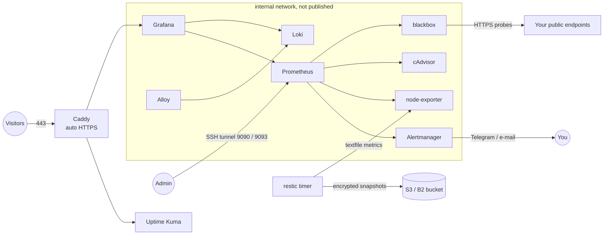

# vps-platform

[](https://github.com/s3nafps/vps-platform/actions/workflows/ci.yml)


[](LICENSE)

A single Linux VPS, hardened and run **entirely from code**. One command takes a fresh
Ubuntu server to a monitored, backed-up host that serves HTTPS services. That
includes alerting, centralized logs and backups that are restore-tested every month.

I built it to run my own services on a Contabo VPS. It is the same discipline I apply
at work, scaled down to one box: no manual changes, every setting reviewable, and
proof that backups actually restore.

## What you get

| Layer | What it does |
|---|---|
| **Hardening** | Admin user with key-only SSH, root login disabled, modern ciphers, UFW default-deny, fail2ban with a repeat-offender jail, kernel network hardening, unattended security updates with a scheduled reboot window |
| **Edge** | Caddy with automatic HTTPS (Let's Encrypt), HTTP/3, HSTS and security headers. **Only ports 80 and 443 are published** |
| **Status page** | Uptime Kuma at `status.<domain>` |
| **Metrics** | Prometheus scraping the host (node-exporter), every container (cAdvisor), Caddy, Loki, Alloy, Alertmanager, plus blackbox HTTPS probes with TLS expiry |
| **Logs** | Grafana Alloy ships container logs and the systemd journal to Loki (14-day retention) |
| **Dashboards** | Grafana with provisioned datasources and a *Platform overview* dashboard: host, containers, endpoints, certificates, backups and error logs |
| **Alerting** | 18 Prometheus rules routed by Alertmanager to Telegram and/or e-mail, with critical alerts suppressing duplicate warnings |
| **Backups** | Nightly restic snapshots of configs and stateful volumes to any S3-compatible bucket (for example Backblaze B2), retention policy, and a **monthly automated restore test** with SQLite integrity checks. Results are exported as metrics, so a missed or failed backup raises an alert |

## Architecture



**Exposure.** Only Caddy listens on public interfaces. Prometheus (9090) and
Alertmanager (9093) bind to `127.0.0.1` and are reached through `make tunnel`.
node-exporter uses the host network for accurate metrics, and UFW blocks its port.
Docker publishes nothing else, which matters because Docker-published ports bypass UFW.

## Quick start

Requirements on your machine: Ansible 2.16+ (`pip install ansible`), and SSH access to a fresh
Ubuntu 24.04/22.04 or Debian 12 VPS. Point two DNS records (for example `status.example.com` and
`grafana.example.com`) at the server.

```bash
git clone https://github.com/s3nafps/vps-platform.git && cd vps-platform
make init                                    # copies the example inventory, vault and stack configs
$EDITOR ansible/inventory/hosts.yml          # server IP
$EDITOR ansible/group_vars/all/main.yml      # domains, your SSH public key, probe targets
$EDITOR ansible/group_vars/all/vault.yml     # Grafana password, restic repo + keys, Telegram token
ansible-vault encrypt ansible/group_vars/all/vault.yml

# First run on a fresh server connects as root; it creates the admin user and disables root login.
cd ansible && ansible-playbook site.yml -e ansible_user=root --ask-vault-pass

# Every run after that:
make deploy
```

Then open `https://status.<domain>` to create the Uptime Kuma admin, and
`https://grafana.<domain>` → *Platform* → *Platform overview*.

### Day-to-day

```bash
make deploy-stack     # change a config or bump an image, apply only the Docker stack
make backup           # take a backup now and print its metrics
make restore-test     # restore the latest snapshot to scratch space and verify it
make tunnel           # Prometheus on localhost:9090, Alertmanager on localhost:9093
```

Runbooks for restores, rotating secrets, adding a service and handling alerts are in
**[docs/runbooks.md](docs/runbooks.md)**.

## Repository layout

```text
ansible/
  site.yml                 # all roles in order
  group_vars/all/          # main.yml (settings) + vault.yml (secrets, encrypted)
  roles/
    base/                  # packages, unattended-upgrades, sysctl, journald, swap
    admin_user/            # admin user, SSH keys, sudo
    ssh_hardening/         # sshd drop-in, validated before restart; handles ssh.socket on Ubuntu 24.04
    firewall/              # UFW: limit SSH, allow 80/443, deny the rest
    fail2ban/              # sshd + recidive jails using the ufw ban action
    docker/                # Docker CE from the official repo, hardened daemon.json
    stack/                 # syncs stack/, renders .env, alertmanager.yml and probe targets, runs Compose
    backup/                # restic, backup + restore-test scripts, systemd timers
  playbooks/               # backup-now.yml, restore-test.yml
stack/
  compose.yml              # 10 services, pinned versions, memory limits, healthchecks
  caddy/ prometheus/ alertmanager/ blackbox/ loki/ alloy/ grafana/
tests/
  smoke.sh                 # starts the real stack and checks it end to end
  ansible.sh               # converges the roles in a systemd container, checks idempotence, verifies
```

## How it is tested

Every push runs four CI jobs:

| Job | What it proves |
|---|---|
| **lint** | `yamllint`; `ansible-lint` on the **production** profile; `shellcheck` on every script |
| **validate** | Each config passes its own validator: `promtool check config`, **alert rule unit tests** (`promtool test rules`), `amtool check-config`, `caddy validate`, `alloy fmt`, `loki -verify-config`, `docker compose config` |
| **smoke** | Starts all 10 containers and checks: HTTPS on both sites, security headers, no `Server` header, **only 80/443 published**, every Prometheus target up, rules loaded, Grafana datasources healthy, dashboard provisioned, container logs arriving in Loki |
| **ansible** | Runs the host roles in an Ubuntu 24.04 systemd container. A second run must report **zero changes**. Verify checks the effective `sshd -T` settings, UFW rules, fail2ban jails, Docker daemon options, backup timers and secret file permissions |

The backup and restore scripts were also exercised against a live stack. That covered a
first-run repository init, a normal backup with retention, a wrong-password failure (the
services restart, the failure metric is set, and the last-success timestamp is kept), and a
full restore with SQLite integrity checks.

## Design decisions

- **Compose, not Kubernetes.** One VPS does not need a scheduler. Compose with
  healthchecks, memory limits and pinned images is simpler to run and to debug at 3 a.m.
- **Config files are synced, secrets are rendered.** The `stack/` directory is the
  source of truth and works on its own (`make init && docker compose up`). Ansible only
  renders the files that hold secrets or host-specific values.
- **Back up what cannot be rebuilt.** Snapshots cover configs, Uptime Kuma, Grafana, Caddy's
  certificates and Alertmanager silences. Prometheus and Loki data are deliberately excluded
  because they can be regenerated, and including them would multiply backup size.
- **SQLite consistency over zero downtime.** Uptime Kuma and Grafana are stopped for the
  few seconds the snapshot takes. The script restarts them even if the backup fails.
- **Backups are monitored like any other service.** A metric that goes stale is louder
  than a cron job that silently stops.

## Roadmap

- Optional WireGuard interface so the tunnel is not needed for Prometheus
- CrowdSec bouncer in front of Caddy
- Off-site copy of the restic repository to a second provider

## License

[MIT](LICENSE) (c) Mohamed Senator
